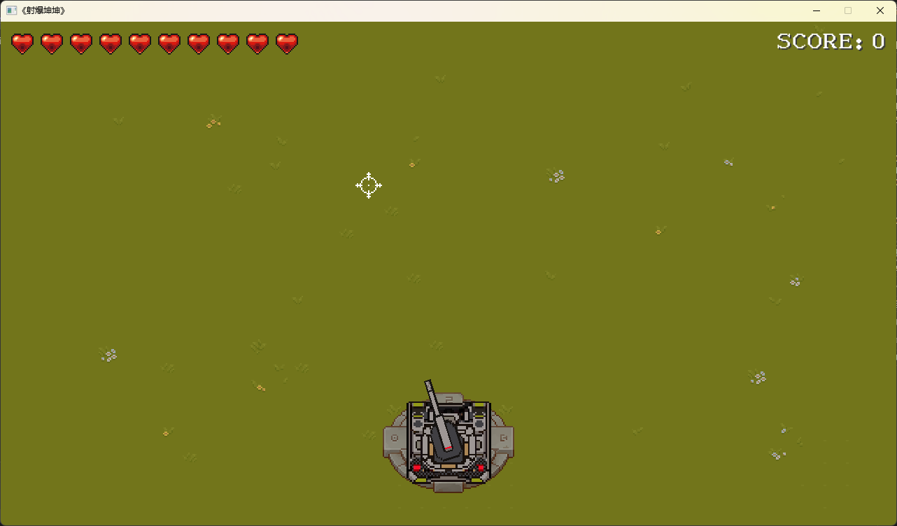
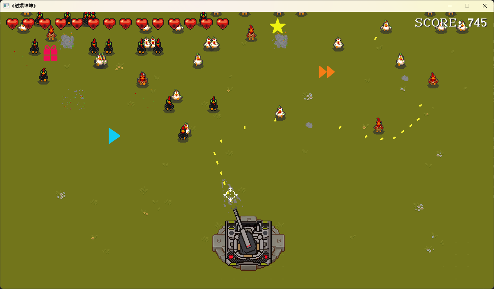

# 射暴坤坤 🐔🔫

一个基于 **C++ + SDL2** 开发的俯视角炮塔射击小游戏。玩家操控屏幕底部的炮台，瞄准并射击从上方不断涌来的"僵尸坤坤"，在 Voidmatrix 基础玩法之上新增了**道具系统**，让战斗更具策略性与趣味性。

## 📸 游戏截图

| 初始界面 | 游戏界面 |
| :---: | :---: |
|  |  |

## 🎮 游戏玩法

- 玩家位于屏幕底部中央操控一门可旋转的炮台，通过**移动鼠标**瞄准方向，**按住鼠标左键**持续开火。
- 僵尸坤坤会从屏幕顶部随机位置生成并向下移动，玩家需要在它们越过底部防线之前将其击落。
- 每漏过一只坤坤，生命值 `-1`；初始生命值为 `10`，归零则游戏结束。
- 游戏难度会随时间递增：坤坤的生成数量每 `8` 秒增加 `1` 只。

### 操作说明

| 操作 | 按键 |
| :--- | :--- |
| 瞄准 | 鼠标移动 |
| 开火 | 鼠标左键（按住连发） |
| 拾取道具 | 鼠标悬停在道具上 + 按住左键 |

## 👾 敌人类型

| 类型 | 出现概率 | 移动速度 | 说明 |
| :--- | :---: | :---: | :--- |
| 慢速坤坤 | 50% | 30 | 移动缓慢，容易瞄准 |
| 中速坤坤 | 30% | 50 | 速度适中 |
| 快速坤坤 | 20% | 80 | 移动迅速，威胁较大 |

## 🎁 道具系统

击败坤坤后有 `3%` 概率掉落道具，鼠标悬停并按住左键即可拾取。道具落地后会先停留一段时间，随后闪烁并消失，请及时拾取！

| 道具 | 效果 | 持续时间 |
| :--- | :--- | :---: |
| 🎁 礼物 | 回复 `1` 点生命值 | 即时 |
| ⚡ 加速 | 炮台射速翻倍 | 5 秒 |
| ⭐ 星星 | 每次发射的子弹数量翻倍 | 2.5 秒 |
| 🛑 暂停 | 全场坤坤停止移动 | 3 秒 |
| ❓ 随机 | 随机触发以上任意一种效果 | 随效果而定 |

## 🛠️ 技术栈

- **语言**：C++
- **图形/音频库**：SDL2、SDL2_image、SDL2_mixer、SDL2_ttf
- **IDE**：Visual Studio（解决方案文件 `射暴坤坤.sln`）
- **分辨率**：1280 × 720
- **帧率**：144 FPS

## 📂 项目结构

```
射暴坤坤/
├── 射暴坤坤/                 # 主工程目录
│   ├── main.cpp              # 游戏入口与主循环
│   ├── kunkun.h              # 坤坤基类
│   ├── kunkun_fast.h         # 快速坤坤
│   ├── kunkun_medium.h       # 中速坤坤
│   ├── kunkun_slow.h         # 慢速坤坤
│   ├── prop.h                # 道具基类
│   ├── gift_prop.h           # 礼物道具（回血）
│   ├── speed_prop.h          # 加速道具
│   ├── star_prop.h           # 星星道具（多重射击）
│   ├── stop_prop.h           # 暂停道具
│   ├── random_prop.h         # 随机道具
│   ├── bullet.h              # 子弹
│   ├── camera.h              # 摄像机（含屏幕震动）
│   ├── animation.h / atlas.h # 动画与图集
│   ├── timer.h               # 定时器
│   ├── vector2.h             # 二维向量
│   └── resources/            # 图片、音效、字体等资源
├── Thirdparty/SDL2/          # SDL2 相关头文件与库
├── msg/                      # README 截图
└── 射暴坤坤.sln              # Visual Studio 解决方案
```

## 🚀 构建与运行

1. 使用 **Visual Studio** 打开 `射暴坤坤.sln`。
2. 确认解决方案配置为 `x86`（项目已内置 SDL2 的 `x86` 运行时 DLL）。
3. 点击「生成」→「开始执行(调试)」即可运行。

> 运行所需的 `SDL2.dll`、`SDL2_image.dll`、`SDL2_mixer.dll`、`SDL2_ttf.dll` 已置于 `射暴坤坤/` 目录下，生成后会随可执行文件一同复制，无需额外配置。

## 🙏 致谢

本项目在 **Voidmatrix** 的基础玩法之上进行扩展，新增了道具掉落与拾取机制，感谢原作者的开源贡献。
